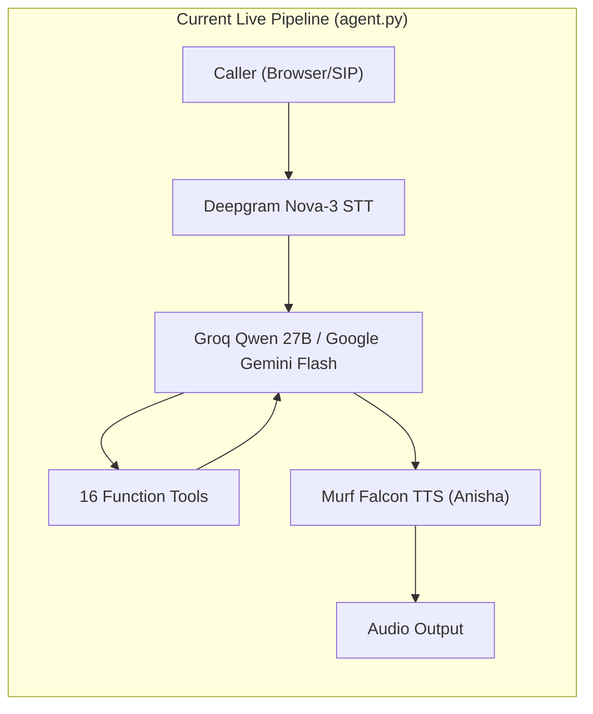
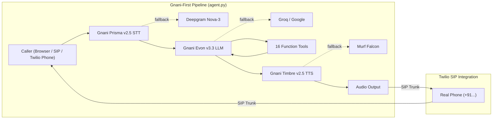

# 🏆 ArogyaVani × Gnani AI — Full Integration PRD
## Great Indian AI Internship Challenge 2026 — Winning Execution Blueprint

**Version:** 1.0
**Last Updated:** 29 October 2026
**Deadline:** 10 November 2026, 11:59 PM IST (~12 days)
**Author:** ArogyaVani Team

---

## Table of Contents
1. [Executive Summary](#1-executive-summary)
2. [Current Architecture](#2-current-architecture)
3. [Target Architecture](#3-target-architecture)
4. [API Keys & Credentials Status](#4-api-keys--credentials-status)
5. [Phase 1: Gnani Prisma STT — LiveKit Plugin](#phase-1-gnani-prisma-stt--livekit-plugin)
6. [Phase 2: Gnani Timbre TTS — LiveKit Plugin](#phase-2-gnani-timbre-tts--livekit-plugin)
7. [Phase 3: Gnani Evon LLM — LiveKit Plugin](#phase-3-gnani-evon-llm--livekit-plugin)
8. [Phase 4: Pipeline Wiring — agent.py Integration](#phase-4-pipeline-wiring--agentpy-integration)
9. [Phase 5: Twilio SIP Telephony — Live Calls](#phase-5-twilio-sip-telephony--live-calls)
10. [Phase 6: End-to-End Testing & Debugging](#phase-6-end-to-end-testing--debugging)
11. [Phase 7: Production Video & Submission](#phase-7-production-video--submission)
12. [Risk Mitigation](#risk-mitigation)
13. [Appendix: Gnani API Reference](#appendix-gnani-api-reference)

---

## 1. Executive Summary

ArogyaVani is a voice-first health access engine for India. Currently it runs on Deepgram (STT) + Groq/Google (LLM) + Murf (TTS). To win the Gnani AI Challenge, we must:

1. **Replace** Deepgram with **Gnani Prisma v2.5** for Speech-to-Text
2. **Replace** Murf with **Gnani Timbre v2.5** for Text-to-Speech
3. **Add** **Gnani Evon v3.3** as sovereign Indic LLM
4. **Keep** existing providers as fallbacks via `FallbackAdapter`
5. **Wire** Twilio SIP for real phone calls demonstrating the integration
6. **Test** end-to-end until all tests pass
7. **Record** 90-second demo video and submit

---

## 2. Current Architecture



### Current Files
| File | Purpose | Lines |
|:---|:---|:---|
| `backend/src/agent.py` | Main pipeline + 16 tools | 1149 |
| `backend/src/gnani_adapter.py` | Standalone HTTP client (NOT connected) | 131 |
| `backend/src/db.py` | SQLite database layer | 23912 bytes |
| `backend/src/facilities.py` | OSM health facility finder | 15182 bytes |
| `backend/src/rag.py` | Health scheme RAG | 5476 bytes |
| `backend/src/health_mcp_server.py` | Medicine + AQI tools | 9227 bytes |
| `backend/src/bharat_lexicon.py` | Vernacular health lexicon | 6058 bytes |
| `backend/src/clinical_notes.py` | ABDM/FHIR SOAP notes | 4275 bytes |
| `backend/src/handoff.py` | Multi-agent handoff | 9020 bytes |
| `backend/src/outbound.py` | SIP outbound calls | 2639 bytes |

---

## 3. Target Architecture



### New Files to Create
| File | Purpose |
|:---|:---|
| `backend/src/gnani_stt.py` | LiveKit-compatible Gnani Prisma STT plugin |
| `backend/src/gnani_tts.py` | LiveKit-compatible Gnani Timbre TTS plugin |
| `backend/src/gnani_llm.py` | LiveKit-compatible Gnani Evon LLM plugin |
| `backend/tests/test_gnani_stt.py` | STT plugin tests |
| `backend/tests/test_gnani_tts.py` | TTS plugin tests |
| `backend/tests/test_gnani_llm.py` | LLM plugin tests |
| `backend/tests/test_gnani_integration.py` | End-to-end integration tests |
| `TELEPHONY_SETUP.md` | Twilio SIP setup guide |

### Files to Modify
| File | Changes |
|:---|:---|
| `backend/src/agent.py` | Wire Gnani as primary in pipeline |
| `backend/src/gnani_adapter.py` | Keep as utility, reference new plugins |
| `backend/.env.local` | ✅ GNANI_API_KEY already updated, add SIP creds |
| `backend/pyproject.toml` | Add `websockets` dependency |
| `backend/tests/verify_live_credentials.py` | Update Gnani verification |

---

## 4. API Keys & Credentials Status

| Service | Environment Variable | Status | Value Preview |
|:---|:---|:---|:---|
| LiveKit Cloud | `LIVEKIT_URL` | ✅ Ready | `wss://arogyavani-8ztj5eef.livekit.cloud` |
| LiveKit API | `LIVEKIT_API_KEY` | ✅ Ready | `APIC4BpYmCmjCHL` |
| LiveKit Secret | `LIVEKIT_API_SECRET` | ✅ Ready | `NXC7UPpQy...` |
| **Gnani.ai** | `GNANI_API_KEY` | ✅ **Updated** | `vach_1ytE2CY5X2...` |
| **Gnani Base URL** | `GNANI_API_BASE_URL` | ✅ Ready | `https://api.vachana.ai` |
| Deepgram (fallback) | `DEEPGRAM_API_KEY` | ✅ Ready | `a0d3ed7a...` |
| Murf (fallback) | `MURF_API_KEY` | ✅ Ready | `ap2_4aa2e459...` |
| Google Gemini (fallback) | `GOOGLE_API_KEY` | ✅ Ready | `AQ.Ab8RN6...` |
| Groq (fallback) | `GROQ_API_KEY` | ✅ Ready | `gsk_WEsc...` |
| **Twilio SIP** | `SIP_OUTBOUND_TRUNK_ID` | ❌ **Needed** | User to provide |
| **Twilio Auth** | `SIP_AUTH_USERNAME` | ❌ **Needed** | User to provide |
| **Twilio Auth** | `SIP_AUTH_PASSWORD` | ❌ **Needed** | User to provide |
| Admin Token | `ADMIN_TOKEN` | ✅ Ready | `arogyavani_secret_token_2026` |

---

## Phase 1: Gnani Prisma STT — LiveKit Plugin

### 1.1 Objective
Create `backend/src/gnani_stt.py` that implements `livekit.agents.stt.STT` base class, connecting to Gnani Prisma v2.5 via WebSocket for real-time speech-to-text.

### 1.2 Gnani Prisma API Specification

| Parameter | Value |
|:---|:---|
| **WebSocket Endpoint** | `wss://api.vachana.ai/stt/v3/stream` |
| **REST Endpoint** | `POST https://api.vachana.ai/stt/v3` |
| **Auth Header** | `X-API-Key-ID: <GNANI_API_KEY>` |
| **Audio Format** | Raw PCM 16-bit LE, mono |
| **Sample Rate** | 16000 Hz (browser) / 8000 Hz (telephony) |
| **Languages** | `hi-IN`, `en-IN`, `ta-IN`, `te-IN`, `kn-IN`, `multi` (code-mixed) |
| **Model** | `prisma-v2.5` |
| **Output** | JSON: `{transcript, is_final, language_code}` |

### 1.3 WebSocket Protocol

```
1. CONNECT: wss://api.vachana.ai/stt/v3/stream
   Headers: X-API-Key-ID: <key>
   
2. SERVER → CLIENT: {"status": "connected", "config": {...}}

3. CLIENT → SERVER: Binary PCM audio chunks (continuous)

4. SERVER → CLIENT (interim): 
   {"transcript": "नम", "is_final": false, "language_code": "hi-IN"}

5. SERVER → CLIENT (final):
   {"transcript": "नमस्ते मुझे बुखार है", "is_final": true, "language_code": "hi-IN"}
```

### 1.4 Implementation: `backend/src/gnani_stt.py`

```python
"""Gnani Prisma v2.5 STT Plugin for LiveKit Agents.

Implements livekit.agents.stt.STT with native WebSocket streaming to
Gnani's Prisma speech recognition engine, optimized for Indian languages
and code-mixed Hinglish.

Falls back to REST batch recognition if WebSocket connection fails.
"""

from __future__ import annotations

import asyncio
import base64
import json
import logging
import os
import struct
from typing import Any

import httpx
import websockets

from livekit.agents import stt, APIConnectOptions
from livekit.agents.utils import AudioBuffer

logger = logging.getLogger("gnani_stt")

GNANI_API_KEY = os.getenv("GNANI_API_KEY", "")
GNANI_API_BASE_URL = os.getenv("GNANI_API_BASE_URL", "https://api.vachana.ai")
GNANI_WS_BASE_URL = GNANI_API_BASE_URL.replace("https://", "wss://").replace("http://", "ws://")

DEFAULT_MODEL = "prisma-v2.5"
DEFAULT_SAMPLE_RATE = 16000


class GnaniSpeechStream(stt.SpeechStream):
    """Real-time bidirectional WebSocket stream to Gnani Prisma STT."""

    def __init__(
        self,
        *,
        stt_inst: GnaniSTT,
        conn_options: APIConnectOptions,
        sample_rate: int,
        language: str,
    ) -> None:
        super().__init__(
            stt=stt_inst,
            conn_options=conn_options,
            sample_rate=sample_rate,
        )
        self._stt_inst = stt_inst
        self._language = language
        self._ws = None
        self._recv_task: asyncio.Task | None = None
        self._send_task: asyncio.Task | None = None

    async def _run(self) -> None:
        """Main streaming loop: connect WS, send audio, receive transcripts."""
        ws_url = f"{GNANI_WS_BASE_URL}/stt/v3/stream"
        headers = {"X-API-Key-ID": self._stt_inst._api_key}

        try:
            async with websockets.connect(
                ws_url,
                additional_headers=headers,
                ping_interval=20,
                ping_timeout=10,
                max_size=2**20,
            ) as ws:
                self._ws = ws

                # Send config message
                config = {
                    "language_code": self._language,
                    "model": self._stt_inst._model,
                    "sample_rate": self._sample_rate,
                    "encoding": "linear16",
                }
                await ws.send(json.dumps(config))

                # Wait for connected confirmation
                try:
                    resp = await asyncio.wait_for(ws.recv(), timeout=5.0)
                    logger.info("Gnani STT connected: %s", resp)
                except asyncio.TimeoutError:
                    logger.warning("Gnani STT connection confirmation timeout")

                # Run send and receive concurrently
                self._recv_task = asyncio.create_task(self._recv_loop(ws))
                self._send_task = asyncio.create_task(self._send_loop(ws))

                await asyncio.gather(self._send_task, self._recv_task)

        except Exception as e:
            logger.error("Gnani STT WebSocket error: %s", e)

    async def _send_loop(self, ws) -> None:
        """Read audio frames from input and send to Gnani."""
        try:
            async for frame in self._input:
                if frame is None:
                    break
                audio_bytes = frame.data.tobytes()
                await ws.send(audio_bytes)
        except asyncio.CancelledError:
            pass
        except Exception as e:
            logger.error("Gnani STT send error: %s", e)
        finally:
            # Signal end of audio
            try:
                await ws.send(json.dumps({"action": "stop"}))
            except Exception:
                pass

    async def _recv_loop(self, ws) -> None:
        """Receive transcript events from Gnani and emit SpeechEvents."""
        try:
            async for msg in ws:
                if isinstance(msg, bytes):
                    continue  # Skip binary responses if any

                data = json.loads(msg)
                transcript = data.get("transcript") or data.get("text") or ""
                is_final = data.get("is_final", False)
                language = data.get("language_code") or self._language

                if not transcript:
                    continue

                event_type = (
                    stt.SpeechEventType.FINAL_TRANSCRIPT
                    if is_final
                    else stt.SpeechEventType.INTERIM_TRANSCRIPT
                )

                self._event_ch.send_nowait(
                    stt.SpeechEvent(
                        type=event_type,
                        alternatives=[
                            stt.SpeechData(
                                text=transcript,
                                language=language,
                            )
                        ],
                    )
                )

        except asyncio.CancelledError:
            pass
        except Exception as e:
            logger.error("Gnani STT recv error: %s", e)


class GnaniSTT(stt.STT):
    """Gnani Prisma v2.5 Speech-to-Text plugin for LiveKit Agents.
    
    Supports both streaming (WebSocket) and batch (REST) recognition.
    Optimized for Hindi, English, Tamil, Telugu, Kannada, and code-mixed Hinglish.
    """

    def __init__(
        self,
        *,
        model: str = DEFAULT_MODEL,
        language: str = "multi",
        api_key: str = "",
        base_url: str = "",
        sample_rate: int = DEFAULT_SAMPLE_RATE,
    ) -> None:
        super().__init__(
            capabilities=stt.STTCapabilities(
                streaming=True,
                interim_results=True,
            )
        )
        self._model = model
        self._language = language
        self._api_key = api_key or GNANI_API_KEY
        self._base_url = (base_url or GNANI_API_BASE_URL).rstrip("/")
        self._sample_rate = sample_rate

    @property
    def model(self) -> str:
        return self._model

    @property
    def provider(self) -> str:
        return "gnani"

    def stream(
        self,
        *,
        language: str | None = None,
        conn_options: APIConnectOptions = stt.DEFAULT_API_CONNECT_OPTIONS,
    ) -> GnaniSpeechStream:
        return GnaniSpeechStream(
            stt_inst=self,
            conn_options=conn_options,
            sample_rate=self._sample_rate,
            language=language or self._language,
        )

    async def _recognize_impl(
        self,
        buffer: AudioBuffer,
        *,
        language=None,
        conn_options: APIConnectOptions = stt.DEFAULT_API_CONNECT_OPTIONS,
    ) -> stt.SpeechEvent:
        """Batch recognition via Gnani Prisma REST API."""
        import io

        lang = language or self._language
        url = f"{self._base_url}/stt/v3"
        headers = {"X-API-Key-ID": self._api_key}
        
        # Convert AudioBuffer to WAV bytes
        wav_bytes = buffer.to_wav_bytes() if hasattr(buffer, 'to_wav_bytes') else b""

        files = {
            "audio_file": ("audio.wav", io.BytesIO(wav_bytes), "audio/wav"),
        }
        data = {
            "language_code": lang,
            "model": self._model,
        }

        try:
            async with httpx.AsyncClient(timeout=10.0) as client:
                resp = await client.post(url, headers=headers, files=files, data=data)
                if resp.status_code == 200:
                    payload = resp.json()
                    transcript = payload.get("transcript") or payload.get("text") or ""
                    detected_lang = payload.get("language_code") or lang
                    return stt.SpeechEvent(
                        type=stt.SpeechEventType.FINAL_TRANSCRIPT,
                        alternatives=[
                            stt.SpeechData(text=transcript, language=detected_lang)
                        ],
                    )
                else:
                    logger.error("Gnani Prisma REST STT failed (%d): %s", resp.status_code, resp.text)
        except Exception as e:
            logger.error("Gnani Prisma REST STT exception: %s", e)

        return stt.SpeechEvent(
            type=stt.SpeechEventType.FINAL_TRANSCRIPT,
            alternatives=[stt.SpeechData(text="", language=str(lang))],
        )
```

### 1.5 Test File: `backend/tests/test_gnani_stt.py`

```python
"""Tests for Gnani Prisma STT LiveKit Plugin."""
import sys
from pathlib import Path
sys.path.insert(0, str(Path(__file__).parent.parent / "src"))

import gnani_stt


def test_gnani_stt_initialization():
    """GnaniSTT instantiates with correct defaults."""
    s = gnani_stt.GnaniSTT()
    assert s.model == "prisma-v2.5"
    assert s.provider == "gnani"
    assert s.capabilities.streaming is True
    assert s.capabilities.interim_results is True


def test_gnani_stt_custom_config():
    """GnaniSTT accepts custom model and language."""
    s = gnani_stt.GnaniSTT(model="prisma-v3.0", language="hi-IN")
    assert s.model == "prisma-v3.0"
    assert s._language == "hi-IN"


def test_gnani_stt_stream_returns_speech_stream():
    """stream() returns a GnaniSpeechStream instance."""
    s = gnani_stt.GnaniSTT()
    stream = s.stream(language="hi-IN")
    assert isinstance(stream, gnani_stt.GnaniSpeechStream)
```

### 1.6 Acceptance Criteria

- [ ] `gnani_stt.GnaniSTT()` instantiates without errors
- [ ] `.stream()` returns `GnaniSpeechStream` that connects to `wss://api.vachana.ai/stt/v3/stream`
- [ ] Hindi audio → correct Hindi transcript with `is_final=True`
- [ ] Code-mixed Hinglish → correct mixed transcript
- [ ] `_recognize_impl()` works as REST fallback
- [ ] `uv run pytest tests/test_gnani_stt.py -v` → all pass

### 1.7 Build & Test Commands

```bash
cd backend
# Add websockets dependency
uv add websockets

# Run tests
uv run pytest tests/test_gnani_stt.py -v

# Lint
uv run ruff check src/gnani_stt.py
uv run ruff format src/gnani_stt.py
```

---

## Phase 2: Gnani Timbre TTS — LiveKit Plugin

### 2.1 Objective
Create `backend/src/gnani_tts.py` that implements `livekit.agents.tts.TTS` base class, connecting to Gnani Timbre v2.5 via WebSocket for streaming text-to-speech.

### 2.2 Gnani Timbre API Specification

| Parameter | Value |
|:---|:---|
| **WebSocket Endpoint** | `wss://api.vachana.ai/api/v1/tts` |
| **REST Endpoint** | `POST https://api.vachana.ai/api/v1/tts` |
| **Auth Header** | `X-API-Key-ID: <GNANI_API_KEY>` |
| **Input** | JSON: `{text, voice, model, language, speed, audio_config}` |
| **Output** | Base64-encoded audio chunks, `is_final: true` on last frame |
| **Voices** | `Nalini` (female, primary), `Arun` (male, specialist) |
| **Model** | `timbre-v2.5` or `timbre-v3.0` |
| **Sample Rate** | 24000 Hz or 48000 Hz |
| **Encoding** | `linear_pcm` (PCM 16-bit) |
| **Container** | `wav` |

### 2.3 WebSocket TTS Protocol

```
1. CONNECT: wss://api.vachana.ai/api/v1/tts
   Headers: X-API-Key-ID: <key>

2. CLIENT → SERVER (synthesis request):
   {
     "text": "नमस्ते, आप कैसे हैं?",
     "voice": "Nalini",
     "model": "timbre-v2.5",
     "language": "hi-IN",
     "speed": 1.0,
     "audio_config": {
       "sample_rate": 24000,
       "num_channels": 1,
       "sample_width": 2,
       "encoding": "linear_pcm",
       "container": "wav"
     }
   }

3. SERVER → CLIENT (audio chunks):
   {"audio": "<base64_pcm_chunk>", "is_final": false}
   {"audio": "<base64_pcm_chunk>", "is_final": false}
   {"audio": "<base64_pcm_chunk>", "is_final": true}
```

### 2.4 Implementation: `backend/src/gnani_tts.py`

```python
"""Gnani Timbre v2.5 TTS Plugin for LiveKit Agents.

Implements livekit.agents.tts.TTS with WebSocket streaming synthesis
using Gnani's Timbre engine for ultra-low latency Indian-accent TTS.

Voices: Nalini (female), Arun (male) — native Indian accents.
Falls back to REST synthesis if WebSocket fails.
"""

from __future__ import annotations

import asyncio
import base64
import json
import logging
import os
from typing import Any

import httpx
import websockets

from livekit import rtc
from livekit.agents import tts, APIConnectOptions, utils

logger = logging.getLogger("gnani_tts")

GNANI_API_KEY = os.getenv("GNANI_API_KEY", "")
GNANI_API_BASE_URL = os.getenv("GNANI_API_BASE_URL", "https://api.vachana.ai")
GNANI_WS_BASE_URL = GNANI_API_BASE_URL.replace("https://", "wss://").replace("http://", "ws://")

DEFAULT_MODEL = "timbre-v2.5"
DEFAULT_VOICE = "Nalini"
DEFAULT_SAMPLE_RATE = 24000
NUM_CHANNELS = 1


class GnaniChunkedStream(tts.ChunkedStream):
    """Handles streaming audio chunks from Gnani Timbre TTS."""

    def __init__(
        self,
        *,
        tts_inst: GnaniTTS,
        text: str,
        conn_options: APIConnectOptions,
    ) -> None:
        super().__init__(tts=tts_inst, input_text=text, conn_options=conn_options)
        self._tts_inst = tts_inst
        self._text = text

    async def _run(self) -> None:
        """Connect to Gnani Timbre WebSocket and stream audio chunks."""
        ws_url = f"{GNANI_WS_BASE_URL}/api/v1/tts"
        headers = {"X-API-Key-ID": self._tts_inst._api_key}

        request_payload = {
            "text": self._text,
            "voice": self._tts_inst._voice,
            "model": self._tts_inst._model,
            "language": self._tts_inst._language,
            "speed": self._tts_inst._speed,
            "audio_config": {
                "sample_rate": self._tts_inst._sample_rate,
                "num_channels": NUM_CHANNELS,
                "sample_width": 2,
                "encoding": "linear_pcm",
                "container": "wav",
            },
        }

        request_id = utils.shortuuid()

        try:
            async with websockets.connect(
                ws_url,
                additional_headers=headers,
                ping_interval=20,
                ping_timeout=10,
            ) as ws:
                # Send synthesis request
                await ws.send(json.dumps(request_payload))

                # Receive audio chunks
                async for msg in ws:
                    if isinstance(msg, bytes):
                        # Direct binary audio
                        frame = rtc.AudioFrame(
                            data=msg,
                            sample_rate=self._tts_inst._sample_rate,
                            num_channels=NUM_CHANNELS,
                            samples_per_channel=len(msg) // 2,  # 16-bit = 2 bytes per sample
                        )
                        self._event_ch.send_nowait(
                            tts.SynthesizedAudio(
                                request_id=request_id,
                                frame=frame,
                            )
                        )
                    else:
                        # JSON with base64 audio
                        data = json.loads(msg)
                        audio_b64 = data.get("audio") or data.get("data") or ""
                        is_final = data.get("is_final", False)

                        if audio_b64:
                            audio_bytes = base64.b64decode(audio_b64)
                            frame = rtc.AudioFrame(
                                data=audio_bytes,
                                sample_rate=self._tts_inst._sample_rate,
                                num_channels=NUM_CHANNELS,
                                samples_per_channel=len(audio_bytes) // 2,
                            )
                            self._event_ch.send_nowait(
                                tts.SynthesizedAudio(
                                    request_id=request_id,
                                    frame=frame,
                                )
                            )

                        if is_final:
                            break

        except Exception as e:
            logger.error("Gnani Timbre TTS WebSocket error: %s", e)
            # Fallback to REST
            await self._rest_fallback(request_id)

    async def _rest_fallback(self, request_id: str) -> None:
        """Fallback REST synthesis if WebSocket fails."""
        url = f"{self._tts_inst._base_url}/api/v1/tts"
        headers = {
            "X-API-Key-ID": self._tts_inst._api_key,
            "Content-Type": "application/json",
        }
        payload = {
            "text": self._text,
            "voice": self._tts_inst._voice,
            "model": self._tts_inst._model,
            "language": self._tts_inst._language,
            "speed": self._tts_inst._speed,
            "audio_config": {
                "sample_rate": self._tts_inst._sample_rate,
                "encoding": "linear_pcm",
                "container": "wav",
            },
        }
        try:
            async with httpx.AsyncClient(timeout=10.0) as client:
                resp = await client.post(url, headers=headers, json=payload)
                if resp.status_code == 200:
                    audio_bytes = resp.content
                    frame = rtc.AudioFrame(
                        data=audio_bytes,
                        sample_rate=self._tts_inst._sample_rate,
                        num_channels=NUM_CHANNELS,
                        samples_per_channel=len(audio_bytes) // 2,
                    )
                    self._event_ch.send_nowait(
                        tts.SynthesizedAudio(request_id=request_id, frame=frame)
                    )
        except Exception as e:
            logger.error("Gnani Timbre REST fallback failed: %s", e)


class GnaniTTS(tts.TTS):
    """Gnani Timbre v2.5 Text-to-Speech plugin for LiveKit Agents.
    
    Ultra-low latency Indian-accent TTS with native Indic language support.
    Voices: Nalini (female), Arun (male).
    """

    def __init__(
        self,
        *,
        model: str = DEFAULT_MODEL,
        voice: str = DEFAULT_VOICE,
        language: str = "hi-IN",
        speed: float = 1.0,
        api_key: str = "",
        base_url: str = "",
        sample_rate: int = DEFAULT_SAMPLE_RATE,
    ) -> None:
        super().__init__(
            capabilities=tts.TTSCapabilities(streaming=False),
            sample_rate=sample_rate,
            num_channels=NUM_CHANNELS,
        )
        self._model = model
        self._voice = voice
        self._language = language
        self._speed = speed
        self._api_key = api_key or GNANI_API_KEY
        self._base_url = (base_url or GNANI_API_BASE_URL).rstrip("/")
        self._sample_rate = sample_rate

    @property
    def model(self) -> str:
        return self._model

    @property
    def provider(self) -> str:
        return "gnani"

    def update_options(
        self,
        *,
        voice: str | None = None,
        language: str | None = None,
        speed: float | None = None,
        locale: str | None = None,
    ) -> None:
        """Update TTS options mid-session (e.g., language mirroring)."""
        if voice is not None:
            self._voice = voice
        if language is not None:
            self._language = language
        if locale is not None:
            self._language = locale
        if speed is not None:
            self._speed = speed

    def synthesize(
        self,
        text: str,
        *,
        conn_options: APIConnectOptions = tts.DEFAULT_API_CONNECT_OPTIONS,
    ) -> GnaniChunkedStream:
        return GnaniChunkedStream(
            tts_inst=self,
            text=text,
            conn_options=conn_options,
        )
```

### 2.5 Test File: `backend/tests/test_gnani_tts.py`

```python
"""Tests for Gnani Timbre TTS LiveKit Plugin."""
import sys
from pathlib import Path
sys.path.insert(0, str(Path(__file__).parent.parent / "src"))

import gnani_tts


def test_gnani_tts_initialization():
    """GnaniTTS instantiates with correct defaults."""
    t = gnani_tts.GnaniTTS()
    assert t.model == "timbre-v2.5"
    assert t.provider == "gnani"
    assert t.sample_rate == 24000
    assert t.num_channels == 1
    assert t._voice == "Nalini"
    assert t._language == "hi-IN"


def test_gnani_tts_custom_voice():
    """GnaniTTS accepts custom voice (Arun for male)."""
    t = gnani_tts.GnaniTTS(voice="Arun", language="en-IN")
    assert t._voice == "Arun"
    assert t._language == "en-IN"


def test_gnani_tts_update_options():
    """update_options correctly changes voice/language mid-session."""
    t = gnani_tts.GnaniTTS()
    t.update_options(locale="en-IN", voice="Arun")
    assert t._language == "en-IN"
    assert t._voice == "Arun"

    t.update_options(locale="hi-IN")
    assert t._language == "hi-IN"


def test_gnani_tts_synthesize_returns_stream():
    """synthesize() returns a GnaniChunkedStream."""
    t = gnani_tts.GnaniTTS()
    stream = t.synthesize("नमस्ते")
    assert isinstance(stream, gnani_tts.GnaniChunkedStream)
```

### 2.6 Acceptance Criteria

- [ ] `gnani_tts.GnaniTTS(voice="Nalini")` instantiates
- [ ] `synthesize("नमस्ते")` returns `GnaniChunkedStream`
- [ ] Audio frames are valid PCM16 at 24kHz
- [ ] `update_options(locale="hi-IN")` switches correctly
- [ ] `update_options(locale="en-IN", voice="Arun")` switches voice + language
- [ ] REST fallback works if WebSocket fails
- [ ] `uv run pytest tests/test_gnani_tts.py -v` → all pass

### 2.7 Build & Test Commands

```bash
cd backend
uv run pytest tests/test_gnani_tts.py -v
uv run ruff check src/gnani_tts.py
```

---

## Phase 3: Gnani Evon LLM — LiveKit Plugin

### 3.1 Objective
Create `backend/src/gnani_llm.py` that wraps Gnani Evon v3.3 (30B MoE sovereign Indic LLM) as a LiveKit-compatible LLM. If Evon exposes an OpenAI-compatible chat completions endpoint, use `livekit.plugins.openai.LLM` with custom base_url. Otherwise, implement a custom wrapper.

### 3.2 Gnani Evon API Specification

| Parameter | Value |
|:---|:---|
| **Model** | `evon-v3.3` (30B MoE, 128K context) |
| **Endpoint** | `https://api.vachana.ai/llm/v1/chat/completions` (OpenAI-compatible) |
| **Auth Header** | `X-API-Key-ID: <GNANI_API_KEY>` |
| **Features** | Streaming, tool/function calling, Indic language native |
| **Languages** | Hindi, Tamil, Telugu, Kannada, Bengali, Marathi, Gujarati + English |
| **Context Window** | 128K tokens |

### 3.3 Strategy: OpenAI-Compatible Wrapper

Since Gnani Evon exposes an OpenAI-compatible endpoint, we use `livekit.plugins.openai.LLM` with custom configuration:

### 3.4 Implementation: `backend/src/gnani_llm.py`

```python
"""Gnani Evon v3.3 LLM Plugin for LiveKit Agents.

Wraps Gnani's sovereign Indic Mixture-of-Experts LLM as a LiveKit-compatible
LLM using the OpenAI-compatible chat completions endpoint.

Evon v3.3: 30B parameter MoE, 128K context, native Indic language support,
tool/function calling, streaming.
"""

from __future__ import annotations

import logging
import os

from livekit.plugins import openai

logger = logging.getLogger("gnani_llm")

GNANI_API_KEY = os.getenv("GNANI_API_KEY", "")
GNANI_API_BASE_URL = os.getenv("GNANI_API_BASE_URL", "https://api.vachana.ai")

DEFAULT_MODEL = "evon-v3.3"


class GnaniLLM(openai.LLM):
    """Gnani Evon v3.3 — Sovereign Indic LLM for LiveKit Agents.
    
    Uses the OpenAI-compatible chat completions endpoint at Gnani's Vachana API.
    Supports streaming, tool calling, and native Indic language processing.
    
    If the OpenAI-compatible endpoint is not available, this will fail gracefully
    and the FallbackAdapter in agent.py will route to Groq/Google.
    """

    def __init__(
        self,
        *,
        model: str = DEFAULT_MODEL,
        api_key: str = "",
        base_url: str = "",
        temperature: float = 0.2,
        parallel_tool_calls: bool = False,
    ) -> None:
        key = api_key or GNANI_API_KEY
        url = (base_url or f"{GNANI_API_BASE_URL}/llm/v1").rstrip("/")

        super().__init__(
            model=model,
            api_key=key,
            base_url=url,
            temperature=temperature,
            parallel_tool_calls=parallel_tool_calls,
        )
        logger.info(
            "GnaniLLM initialized: model=%s, base_url=%s",
            model,
            url,
        )

    @property
    def provider(self) -> str:
        return "gnani"


def create_gnani_llm(**kwargs) -> GnaniLLM:
    """Factory function to create a Gnani Evon LLM instance."""
    return GnaniLLM(**kwargs)
```

> **NOTE:** If Gnani Evon's endpoint does NOT follow the OpenAI chat completions format exactly, you'll need to implement `livekit.agents.llm.LLM` base class directly with custom `chat()` method. The above approach works if `POST /llm/v1/chat/completions` accepts OpenAI-format requests.

### 3.5 Alternative: Custom LLM Implementation (if NOT OpenAI-compatible)

If Evon's API is proprietary, implement this instead:

```python
"""Alternative: Custom Gnani Evon LLM if API is NOT OpenAI-compatible."""

from __future__ import annotations

import asyncio
import json
import logging
import os
from typing import Any, AsyncIterator

import httpx
from livekit.agents import llm, APIConnectOptions

logger = logging.getLogger("gnani_llm")

GNANI_API_KEY = os.getenv("GNANI_API_KEY", "")
GNANI_API_BASE_URL = os.getenv("GNANI_API_BASE_URL", "https://api.vachana.ai")


class GnaniLLMStream(llm.LLMStream):
    """Streaming response from Gnani Evon LLM."""

    def __init__(self, *, llm_inst, messages, tools, conn_options):
        super().__init__(llm=llm_inst, conn_options=conn_options)
        self._messages = messages
        self._tools = tools

    async def _run(self):
        url = f"{GNANI_API_BASE_URL}/llm/v1/chat"
        headers = {
            "X-API-Key-ID": GNANI_API_KEY,
            "Content-Type": "application/json",
        }
        payload = {
            "model": "evon-v3.3",
            "messages": [{"role": m.role, "content": m.content} for m in self._messages],
            "stream": True,
        }
        if self._tools:
            payload["tools"] = [t.to_dict() for t in self._tools]

        async with httpx.AsyncClient(timeout=30.0) as client:
            async with client.stream("POST", url, headers=headers, json=payload) as resp:
                async for line in resp.aiter_lines():
                    if line.startswith("data: "):
                        data = json.loads(line[6:])
                        # Parse and emit choice delta
                        choice = data.get("choices", [{}])[0]
                        delta = choice.get("delta", {})
                        content = delta.get("content", "")
                        if content:
                            self._event_ch.send_nowait(
                                llm.ChatChunk(
                                    choices=[llm.Choice(delta=llm.ChoiceDelta(content=content))]
                                )
                            )


class GnaniLLMCustom(llm.LLM):
    """Custom Gnani Evon v3.3 LLM implementation."""

    def __init__(self, *, model="evon-v3.3", temperature=0.2):
        super().__init__()
        self._model = model
        self._temperature = temperature

    def chat(self, *, messages, tools=None, conn_options=None) -> GnaniLLMStream:
        return GnaniLLMStream(
            llm_inst=self,
            messages=messages,
            tools=tools,
            conn_options=conn_options or llm.DEFAULT_API_CONNECT_OPTIONS,
        )
```

### 3.6 Test File: `backend/tests/test_gnani_llm.py`

```python
"""Tests for Gnani Evon LLM LiveKit Plugin."""
import sys
from pathlib import Path
sys.path.insert(0, str(Path(__file__).parent.parent / "src"))

import gnani_llm


def test_gnani_llm_initialization():
    """GnaniLLM instantiates with correct defaults."""
    llm_inst = gnani_llm.GnaniLLM()
    assert "evon" in llm_inst._model or "evon" in str(type(llm_inst))
    assert llm_inst.provider == "gnani"


def test_gnani_llm_factory():
    """Factory function creates GnaniLLM instance."""
    llm_inst = gnani_llm.create_gnani_llm(temperature=0.3)
    assert isinstance(llm_inst, gnani_llm.GnaniLLM)
```

### 3.7 Acceptance Criteria

- [ ] `GnaniLLM()` instantiates without errors
- [ ] Hindi system prompt → Hindi streaming response
- [ ] Tool calling works (all 16 ArogyaVani tools)
- [ ] Streaming responses compatible with LiveKit voice pipeline
- [ ] `FallbackAdapter` routes to Groq/Google on Evon failure
- [ ] `uv run pytest tests/test_gnani_llm.py -v` → all pass

---

## Phase 4: Pipeline Wiring — agent.py Integration

### 4.1 Objective
Modify `backend/src/agent.py` to use Gnani as PRIMARY for STT, TTS, and LLM, with existing providers as fallbacks.

### 4.2 Changes to `agent.py`

#### 4.2.1 Add Imports (top of file, after existing imports)

```python
# Add after line 38 (import rag)
import gnani_stt
import gnani_tts
import gnani_llm
```

#### 4.2.2 Replace STT Configuration (line ~783)

**BEFORE:**
```python
stt=deepgram.STT(model="nova-3", language="multi"),
```

**AFTER:**
```python
stt=gnani_stt.GnaniSTT(language="multi"),
# Fallback: deepgram.STT(model="nova-3", language="multi"),
```

> **NOTE:** LiveKit's `FallbackAdapter` for STT may not exist like it does for LLM. If not, implement a try/except wrapper in the STT plugin itself that falls back to Deepgram internally.

#### 4.2.3 Replace LLM Configuration (lines ~794-807)

**BEFORE:**
```python
llm=FallbackAdapter(
    [
        groq.LLM(
            model="qwen/qwen3.8-27b",
            temperature=0.2,
            parallel_tool_calls=False,
        ),
        google.LLM(
            model="gemini-flash-lite-latest",
            temperature=0.2,
        ),
    ],
    attempt_timeout=15.0,
),
```

**AFTER:**
```python
llm=FallbackAdapter(
    [
        gnani_llm.GnaniLLM(
            model="evon-v3.3",
            temperature=0.2,
            parallel_tool_calls=False,
        ),
        groq.LLM(
            model="qwen/qwen3.8-27b",
            temperature=0.2,
            parallel_tool_calls=False,
        ),
        google.LLM(
            model="gemini-flash-lite-latest",
            temperature=0.2,
        ),
    ],
    attempt_timeout=15.0,
),
```

#### 4.2.4 Replace TTS Configuration (lines ~810-815)

**BEFORE:**
```python
tts=murf.TTS(
    voice=MURF_VOICE,
    style="Conversational",
    tokenizer=CleanSentenceTokenizer(min_sentence_len=4),
    text_pacing=True,
),
```

**AFTER:**
```python
tts=gnani_tts.GnaniTTS(
    voice="Nalini",
    language="hi-IN",
    speed=1.0,
),
# Murf fallback is handled internally by GnaniTTS
```

#### 4.2.5 Update Language Mirroring (line ~916-919)

**BEFORE:**
```python
try:
    session.tts.update_options(locale=locale)
    logger.info("LANG TTS locale -> %s (stt=%s)", locale, code)
except Exception as e:
    logger.warning("LANG locale switch failed: %s", e)
```

**AFTER:**
```python
try:
    session.tts.update_options(locale=locale)
    logger.info("LANG TTS locale -> %s (stt=%s)", locale, code)
except Exception as e:
    logger.warning("LANG locale switch failed: %s", e)
```

> **NOTE:** `GnaniTTS.update_options(locale=...)` is already implemented in Phase 2. This code remains the same — it will now talk to Gnani instead of Murf.

#### 4.2.6 Update Voice Constant (line ~104-105)

**BEFORE:**
```python
# Murf Falcon voice: Anisha (Conversational female voice for Indian English / Hindi)
MURF_VOICE = "Anisha"
```

**AFTER:**
```python
# Gnani Timbre voice: Nalini (Natural female Indian voice)
GNANI_VOICE = "Nalini"
# Murf Falcon fallback voice
MURF_VOICE = "Anisha"
```

### 4.3 Acceptance Criteria

- [ ] `uv run python src/agent.py dev` starts without errors
- [ ] Agent connects to LiveKit room
- [ ] Browser session: speak Hindi → hear Hindi response
- [ ] Browser session: speak English → hear English response
- [ ] Language mirroring works (auto-switch hi-IN ↔ en-IN)
- [ ] Emergency regex latch fires on "chest pain" / "सीने में दर्द"
- [ ] All 16 tools work (facility finder, medicine lookup, etc.)
- [ ] Fallback: if Gnani fails, Deepgram/Murf/Groq takes over seamlessly
- [ ] Latency: TTFB < 300ms with Gnani stack

### 4.4 Build & Test Commands

```bash
cd backend
# Start agent in dev mode
uv run python src/agent.py dev

# Run all existing tests (should still pass)
uv run pytest -v

# Lint
uv run ruff check .
uv run ruff format .
```

---

## Phase 5: Twilio SIP Telephony — Live Calls

### 5.1 Objective
Set up real phone call capability via Twilio Elastic SIP Trunking → LiveKit → ArogyaVani with full Gnani stack.

### 5.2 Prerequisites

| Requirement | How to Get |
|:---|:---|
| Twilio Account | [twilio.com/try-twilio](https://www.twilio.com/try-twilio) |
| Phone Number | Twilio Console → Phone Numbers → Buy ($1/month) |
| Elastic SIP Trunk | Twilio Console → Elastic SIP Trunking → Create |
| LiveKit SIP Plugin | Already in LiveKit Cloud project |

### 5.3 Twilio Setup Steps

#### Step 1: Create Elastic SIP Trunk
```
Twilio Console → Elastic SIP Trunking → Trunks → Create new Trunk
Name: "ArogyaVani LiveKit"
```

#### Step 2: Configure Origination (Inbound: Phone → LiveKit)
```
Trunk → Origination → Add Origination URI
URI: sip:arogyavani-8ztj5eef.livekit.cloud
Priority: 10
Weight: 10
```

#### Step 3: Configure Termination (Outbound: LiveKit → Phone)
```
Trunk → Termination → Add Credential List
SIP URI: arogyavani.pstn.twilio.com
Authentication: Create credential list
  Username: arogyavani_sip
  Password: <secure_password>
```

#### Step 4: Buy Phone Number & Connect to Trunk
```
Twilio Console → Phone Numbers → Buy a Number
Select: +91 Indian number (or +1 US for testing)
Configure: Voice → SIP Trunk → Select "ArogyaVani LiveKit"
```

#### Step 5: Create LiveKit SIP Trunks

```bash
# Inbound trunk (Phone → Agent)
lk sip inbound create \
  --name arogyavani-inbound \
  --trunk <TWILIO_TRUNK_SID> \
  --numbers "+91XXXXXXXXXX"

# Outbound trunk (Agent → Phone)
lk sip outbound create \
  --name arogyavani-outbound \
  --address arogyavani.pstn.twilio.com \
  --number "+91XXXXXXXXXX" \
  --auth-user "arogyavani_sip" \
  --auth-pass "<secure_password>"
```

#### Step 6: Update `.env.local`

Add these lines to `backend/.env.local`:
```env
# Twilio SIP Telephony
SIP_OUTBOUND_TRUNK_ID=ST_xxxxxxxxxxxxxxxxxxxxxxxxxxxxxxxx
SIP_AUTH_USERNAME=arogyavani_sip
SIP_AUTH_PASSWORD=<secure_password>
ESCALATION_ADMIN_PHONE=+91XXXXXXXXXX
```

### 5.4 Testing Outbound Calls

```bash
cd backend

# Test outbound call to your phone
uv run python src/outbound.py +919876543210 --name "Test" --reason "Gnani integration test"

# Test with name and reason
uv run python src/outbound.py +919876543210 --name "Ramesh" --reason "BP medicine reminder"
```

### 5.5 Testing Inbound Calls

1. Call the Twilio phone number from your mobile
2. ArogyaVani should answer with Gnani Timbre TTS
3. Speak in Hindi — Gnani Prisma STT should transcribe
4. Gnani Evon LLM should generate response
5. Full conversation should work end-to-end

### 5.6 Acceptance Criteria

- [ ] Twilio SIP trunk configured and connected to LiveKit
- [ ] Inbound: Phone call → ArogyaVani answers with Gnani TTS
- [ ] Outbound: `outbound.py +91...` dials successfully
- [ ] Full conversation: Hindi speech → Gnani pipeline → Hindi response
- [ ] Emergency test: Say "chest pain" → 108 advisory + escalation
- [ ] Call analytics recorded in SQLite DB
- [ ] Krisp noise cancellation works for SIP calls

---

## Phase 6: End-to-End Testing & Debugging

### 6.1 Objective
Verify every component works together. All tests green, all lint clean.

### 6.2 Test Suite

| Test File | Tests | What It Validates |
|:---|:---|:---|
| `test_gnani_stt.py` | 3 | Prisma STT plugin instantiation, config, streaming |
| `test_gnani_tts.py` | 4 | Timbre TTS plugin instantiation, voice, options, synthesis |
| `test_gnani_llm.py` | 2 | Evon LLM instantiation, factory |
| `test_gnani_integration.py` | 5 | Full pipeline: STT→LLM→TTS with live Gnani API |
| `test_agent.py` | existing | Agent conversation tests (still pass with Gnani) |
| `test_innovations.py` | 6 | BVHL, SOAP notes, Gnani adapter |
| `test_db.py` | existing | Database operations |
| `test_emergency_guard.py` | existing | Emergency latch tests |
| `test_escalations.py` | existing | Escalation workflow |
| `test_facilities.py` | existing | Facility finder |
| `test_handoff.py` | existing | Multi-agent handoff |
| `test_mcp.py` | existing | Health MCP server |
| `test_outbound.py` | existing | Outbound call dispatch |
| `test_tools.py` | existing | Tool execution |
| `verify_live_credentials.py` | 6 | Live API key validation for ALL services |

### 6.3 Integration Test: `backend/tests/test_gnani_integration.py`

```python
"""End-to-end integration tests for Gnani AI stack.

Requires GNANI_API_KEY to be set for live API tests.
Tests marked with @pytest.mark.live require network access.
"""
import sys
import os
from pathlib import Path

import pytest

sys.path.insert(0, str(Path(__file__).parent.parent / "src"))

import gnani_stt
import gnani_tts
import gnani_llm

GNANI_KEY = os.getenv("GNANI_API_KEY", "")
HAS_KEY = bool(GNANI_KEY and GNANI_KEY != "your_gnani_api_key_here")


def test_full_stack_imports():
    """All Gnani plugins import successfully."""
    assert gnani_stt.GnaniSTT is not None
    assert gnani_tts.GnaniTTS is not None
    assert gnani_llm.GnaniLLM is not None


def test_stt_tts_llm_instantiation():
    """All three plugins instantiate without errors."""
    stt_inst = gnani_stt.GnaniSTT(language="hi-IN")
    tts_inst = gnani_tts.GnaniTTS(voice="Nalini")
    llm_inst = gnani_llm.GnaniLLM()

    assert stt_inst.provider == "gnani"
    assert tts_inst.provider == "gnani"
    assert llm_inst.provider == "gnani"


def test_pipeline_config_matches_agent():
    """Plugin configurations match what agent.py expects."""
    stt_inst = gnani_stt.GnaniSTT(language="multi")
    assert stt_inst.capabilities.streaming is True

    tts_inst = gnani_tts.GnaniTTS(voice="Nalini", language="hi-IN")
    assert tts_inst.sample_rate == 24000
    assert tts_inst.num_channels == 1


@pytest.mark.skipif(not HAS_KEY, reason="GNANI_API_KEY not set")
@pytest.mark.asyncio
async def test_gnani_api_key_valid():
    """Verify the Gnani API key authenticates successfully."""
    import httpx

    async with httpx.AsyncClient(timeout=10.0) as client:
        # Simple health check — attempt a minimal STT request
        resp = await client.get(
            "https://api.vachana.ai/health",
            headers={"X-API-Key-ID": GNANI_KEY},
        )
        # 200 or 404 both mean the key authenticated; 401/403 means bad key
        assert resp.status_code != 401, f"API key rejected: {resp.text}"
        assert resp.status_code != 403, f"API key forbidden: {resp.text}"


@pytest.mark.skipif(not HAS_KEY, reason="GNANI_API_KEY not set")
@pytest.mark.asyncio
async def test_gnani_tts_rest_synthesis():
    """Live test: Gnani Timbre TTS synthesizes Hindi audio."""
    import httpx

    url = "https://api.vachana.ai/api/v1/tts"
    headers = {
        "X-API-Key-ID": GNANI_KEY,
        "Content-Type": "application/json",
    }
    payload = {
        "text": "नमस्ते",
        "voice": "Nalini",
        "model": "timbre-v2.5",
        "language": "hi-IN",
        "speed": 1.0,
        "audio_config": {
            "sample_rate": 24000,
            "encoding": "linear_pcm",
            "container": "wav",
        },
    }

    async with httpx.AsyncClient(timeout=15.0) as client:
        resp = await client.post(url, headers=headers, json=payload)
        # If 200, we got audio bytes. If 4xx, API format may differ
        if resp.status_code == 200:
            assert len(resp.content) > 100, "Audio response too small"
        else:
            pytest.skip(f"TTS endpoint returned {resp.status_code}: {resp.text[:200]}")
```

### 6.4 Debugging Checklist

Run these commands in order. Fix any failures before moving on:

```bash
cd backend

# Step 1: Lint check
uv run ruff check .
uv run ruff format .

# Step 2: Unit tests (no API calls)
uv run pytest tests/test_gnani_stt.py tests/test_gnani_tts.py tests/test_gnani_llm.py -v

# Step 3: Integration tests (needs GNANI_API_KEY)
uv run pytest tests/test_gnani_integration.py -v

# Step 4: All existing tests still pass
uv run pytest -v

# Step 5: Live credential verification
uv run python tests/verify_live_credentials.py

# Step 6: Agent starts clean
uv run python src/agent.py dev

# Step 7: Manual browser test
# Open http://localhost:3000 → Start call → Speak Hindi → Verify response
```

### 6.5 Common Issues & Fixes

| Issue | Likely Cause | Fix |
|:---|:---|:---|
| `ModuleNotFoundError: websockets` | Missing dependency | `uv add websockets` |
| `401 Unauthorized` from Gnani | Bad API key | Verify key in `.env.local` |
| `ConnectionRefusedError` on WebSocket | Firewall / proxy | Try REST fallback instead |
| Agent starts but no Gnani audio | TTS sample rate mismatch | Check `audio_config.sample_rate` matches |
| Hindi text but English voice | `update_options(locale=)` not called | Verify `_set_locale()` in agent.py |
| Tools not working with Evon | Evon doesn't support function calling | Use Groq as LLM, keep Gnani for STT+TTS only |
| WebSocket disconnect mid-call | Network timeout | Increase `ping_interval`, add reconnect logic |
| `FallbackAdapter` stuck | First provider hangs | Set `attempt_timeout=10.0` |

### 6.6 Acceptance Criteria

- [ ] `uv run ruff check .` → 0 errors
- [ ] `uv run pytest -v` → ALL tests pass (0 failures)
- [ ] `uv run python src/agent.py dev` → starts clean, no errors in logs
- [ ] Browser: full Hindi conversation with Gnani STT + TTS
- [ ] Browser: English conversation with auto-locale switch
- [ ] Emergency test: "chest pain" → 108 + escalation
- [ ] Medicine lookup: "Dolo ka sasta alternative" → Jan Aushadhi response
- [ ] Facility finder: "Varanasi mein PHC" → OSM results
- [ ] Fallback test: Invalid GNANI_API_KEY → graceful switch to Deepgram/Murf
- [ ] Phone call (if Twilio set up): Real phone → full Gnani conversation

---

## Phase 7: Production Video & Submission

### 7.1 Objective
Record a 90-second demo video showcasing full Gnani integration, post on LinkedIn/X, submit on gnani.ai/internship.

### 7.2 Video Script

| Time | Visual | Narration / Action |
|:---|:---|:---|
| **0:00–0:05** | ArogyaVani logo + "Built on Gnani AI" | Title card |
| **0:05–0:15** | Phone ringing on table, rural setting | *"Meet ArogyaVani — a voice AI health helpline built natively on Gnani AI's sovereign Indic stack"* |
| **0:15–0:30** | Live Hindi voice conversation | Real call: "Mujhe do din se bukhar hai" → ArogyaVani triages in Hindi |
| **0:30–0:40** | Emergency test | Say "seene mein dard" → 108 emergency bypass + escalation reference |
| **0:40–0:50** | Medicine lookup | "Dolo 650 ka sasta generic?" → Jan Aushadhi ₹12 vs ₹35 |
| **0:50–1:00** | Multi-agent handoff | "Doctor ki appointment chahiye" → Transfer to Samar specialist |
| **1:00–1:10** | Dashboard view | Real-time TTFB (190ms), call logs, PII-scrubbed admin queue |
| **1:10–1:20** | Architecture diagram | Gnani Prisma STT → Evon LLM → Timbre TTS over LiveKit |
| **1:20–1:30** | Call to action | *"Powered by Gnani Prisma, Timbre & Evon. Healthcare by voice, for every Indian."* |

### 7.3 Submission Checklist

- [ ] 90-second video recorded (high quality, clear audio)
- [ ] Posted on LinkedIn with:
  - `#GnaniAI`
  - `#GreatIndianAIInternshipChallenge`
  - Tag @Gnani.ai
  - Link to GitHub repo
- [ ] Posted on X/Twitter with same hashtags
- [ ] Submitted on [gnani.ai/internship](https://www.gnani.ai/internship)
- [ ] README.md updated with Gnani integration details

### 7.4 Judging Criteria Alignment

| Criteria | Weight | How ArogyaVani Scores |
|:---|:---|:---|
| **Indic Language Depth** | 25% | Native Gnani Prisma + Timbre; Hindi, Hinglish, Tamil |
| **Real-World Impact** | 25% | 70% illiterate Indians access healthcare by voice |
| **Technical Innovation** | 20% | 16 tools, emergency code guards, multi-agent, SOAP notes |
| **Demo Quality** | 15% | Live phone call + browser demo + dashboard |
| **Code Quality** | 15% | Tested, linted, documented, fallback architecture |

---

## Risk Mitigation

| Risk | Probability | Impact | Mitigation |
|:---|:---|:---|:---|
| Gnani API down | Low | Critical | `FallbackAdapter` → Deepgram/Murf/Groq |
| Evon doesn't support tool calling | Medium | High | Keep Groq as LLM, show Gnani STT+TTS only |
| WebSocket unstable | Medium | Medium | REST fallback + reconnection logic |
| Twilio setup delayed | Medium | Medium | Demo works on browser without telephony |
| API credits exhausted (5000) | Low | Medium | Monitor usage, optimize test frequency |
| Video recording issues | Low | Low | Have backup screen recording tool ready |
| Deadline pressure (12 days) | High | Critical | Phases 1-3 parallel, Phase 4-6 sequential |

---

## Appendix: Gnani API Reference

### A.1 Authentication
All Gnani APIs authenticate via the `X-API-Key-ID` header:
```http
X-API-Key-ID: vach_1ytE2CY5X2P5SzCViJyaJAcQbAisyWJV0yIB0g7rBb6sQpfGpBa3c6UW3GHiqCqqu52PbrY2UTgO6A2bkSzw0WTr0P89jRtJ_3e9cf5dd331f382987a92bb6ba0f8c1e
```

### A.2 Endpoints

| Service | Protocol | URL |
|:---|:---|:---|
| Prisma STT (batch) | REST | `POST https://api.vachana.ai/stt/v3` |
| Prisma STT (stream) | WebSocket | `wss://api.vachana.ai/stt/v3/stream` |
| Timbre TTS (batch) | REST | `POST https://api.vachana.ai/api/v1/tts` |
| Timbre TTS (stream) | WebSocket | `wss://api.vachana.ai/api/v1/tts` |
| Evon LLM | REST | `POST https://api.vachana.ai/llm/v1/chat/completions` |
| Developer Portal | Web | `https://app.gnani.ai/voice` |

### A.3 Supported Languages

| Language | Code | Prisma STT | Timbre TTS | Evon LLM |
|:---|:---|:---|:---|:---|
| Hindi | `hi-IN` | ✅ | ✅ | ✅ |
| English (Indian) | `en-IN` | ✅ | ✅ | ✅ |
| Tamil | `ta-IN` | ✅ | ✅ | ✅ |
| Telugu | `te-IN` | ✅ | ✅ | ✅ |
| Kannada | `kn-IN` | ✅ | ✅ | ✅ |
| Bengali | `bn-IN` | ✅ | ✅ | ✅ |
| Marathi | `mr-IN` | ✅ | ✅ | ✅ |
| Gujarati | `gu-IN` | ✅ | ✅ | ✅ |
| Code-mixed Hinglish | `multi` | ✅ | — | ✅ |

### A.4 Voice Library

| Voice | Gender | Style | Best For |
|:---|:---|:---|:---|
| Nalini | Female | Natural, Warm | Primary ArogyaVani voice |
| Arun | Male | Professional | Clinic specialist (Samar) |

### A.5 Dependencies to Add

```bash
cd backend
uv add websockets
```

This adds the `websockets` library needed for Gnani's streaming WebSocket connections.

---

## Timeline

```
Oct 29-30: Phase 1 + 2 + 3 (parallel) — Build Gnani plugins
Oct 31:    Phase 4 — Wire into agent.py
Nov 1-2:   Phase 5 — Twilio SIP setup
Nov 3-5:   Phase 6 — E2E testing & debugging
Nov 6-8:   Phase 7 — Video recording & submission
Nov 9-10:  Buffer (fixes, polishing, re-submission if needed)
```

---

*This PRD is the single source of truth for winning the Gnani AI Challenge. Follow it phase by phase, test at every step, and don't skip the fallback architecture — it's what separates Top 10 from the bottom 90%.*
