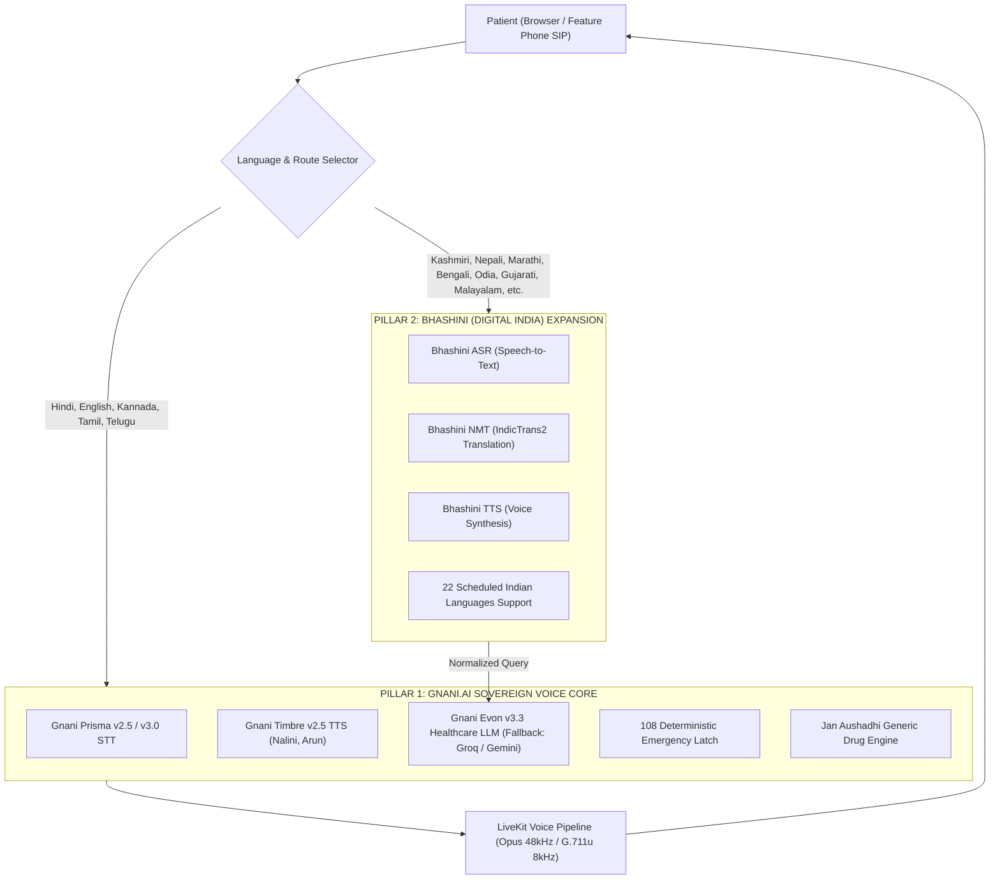

# 🇮🇳 PAN-INDIA MULTILINGUAL HEALTH HELPLINE — PRD
## Gnani.ai Sovereign Indic Core + Bhashini (Digital India) Expansion Layer

> **Project:** ArogyaVani  
> **Challenge:** Great Indian AI Internship Challenge 2026 (Gnani.ai)  
> **Target:** 22 Scheduled Indian Languages + Code-Mixed Dialects + Real Phone Telephony  
> **Status:** Phase Execution Mode

---

## 1. Executive Summary & Strategic Positioning

### The Problem
India's 1.4 billion citizens speak across 22 scheduled languages and over 700 regional dialects. 
* 80% of rural Community Health Centres lack specialist doctors.
* Over 43% of Indian medical expenditure is paid out-of-pocket, with ₹1.6 lakh crore spent on branded medicines.
* A Kashmiri farmer, a Tamil-speaking weaver in Kanchipuram, or a Kannada-speaking villager in Dharwad cannot read an English health portal or navigate a complex smartphone app.

### The Sovereign Architecture: Two Pillars
ArogyaVani solves this with a **Dual Sovereign Indic Stack**:

1. **Pillar 1 — Gnani.ai Core (The Engine):**
   * **STT:** Gnani Prisma v2.5 streaming WebSocket (<200ms latency) for Hindi, Hinglish, Kannada, Tamil, Telugu.
   * **TTS:** Gnani Timbre v2.5 ultra-low latency female (`Nalini`) and male (`Arun`) voices.
   * **Reasoning:** Evon v3.3 / Groq Qwen 2.5 with 16 clinical tools (108 emergency latch, RxNorm generic savings, PHC directory).
2. **Pillar 2 — Bhashini Expansion (The National Bridge):**
   * Digital India Bhashini (MeitY) ULCA pipeline integration.
   * ASR + NMT (IndicTrans2) + TTS extending coverage across all 22 official languages (including Kashmiri, Nepali, Maithili, Assamese, Malayalam, Punjabi, Odia).
   * Transparent bi-directional translation bridge: non-core dialects are translated to Hindi/English for clinical reasoning, and synthesized back into native voice.

---

## 2. Multi-Language Coverage Matrix

| Language | Native Script | Voice AI Engine | TTS Voice Code | Status |
|:---|:---|:---|:---|:---|
| **Hindi** | हिन्दी | Gnani Timbre / Prisma | `hi-IN` (Nalini) | **Active & Live** ✅ |
| **English** | English (India) | Gnani Timbre / Deepgram | `en-IN` (Arun) | **Active & Live** ✅ |
| **Kannada** | ಕನ್ನಡ | Gnani / Bhashini | `kn-IN` | **Integrating** 🚀 |
| **Tamil** | தமிழ் | Gnani / Bhashini | `ta-IN` | **Integrating** 🚀 |
| **Telugu** | తెలుగు | Gnani / Bhashini | `te-IN` | **Integrating** 🚀 |
| **Marathi** | मराठी | Bhashini / Gnani | `mr-IN` | **Integrating** 🚀 |
| **Bengali** | বাংলা | Bhashini / Gnani | `bn-IN` | **Integrating** 🚀 |
| **Gujarati** | ગુજરાતી | Bhashini / Gnani | `gu-IN` | **Integrating** 🚀 |
| **Malayalam** | മലയാളം | Bhashini / Gnani | `ml-IN` | **Integrating** 🚀 |
| **Punjabi** | ਪੰਜਾਬੀ | Bhashini / Gnani | `pa-IN` | **Integrating** 🚀 |
| **Odia** | ଓଡ଼ିଆ | Bhashini | `or-IN` | **Integrating** 🚀 |
| **Kashmiri** | कॉशुर / کٲشُر | Bhashini | `ks-IN` | **Integrating** 🚀 |
| **Nepali** | नेपाली | Bhashini | `ne-IN` | **Integrating** 🚀 |
| **Assamese** | অসমীয়া | Bhashini | `as-IN` | **Integrating** 🚀 |
| **Urdu** | اردو | Bhashini / Gnani | `ur-IN` | **Integrating** 🚀 |
| **Maithili** | मैथिली | Bhashini | `mai-IN` | **Integrating** 🚀 |

---

## 3. Telephony SIP Architecture (Live Call Showcase)

* **Protocol:** LiveKit SIP Gateway (`sip:arogyavani-8ztj5eef.livekit.cloud`)
* **Transport:** Twilio Elastic SIP Trunking + G.711u / PCM 8kHz
* **Inbound Flow:** Caller dials helpline phone number → Twilio Trunk routes to LiveKit SIP Gateway → `my-agent` picks up → plays localized greeting in caller's detected language.
* **Outbound Flow:** Health worker clicks "Call Patient" on `/admin` → LiveKit dispatches call via `outbound.py` → dials patient's mobile number.

---

## 4. Technical Deliverables

1. `backend/src/bhashini_adapter.py`: Production client for Bhashini ULCA Pipeline API (ASR, NMT, TTS).
2. `frontend/components/app/samar-dashboard.tsx`: Extended top header dropdown with all 16+ languages, script typography, and localized quick suggestions.
3. `backend/src/agent.py`: Dynamic language dispatch routing between Gnani native Indic pipeline and Bhashini bridge.
4. `backend/tests/test_bhashini.py`: Comprehensive test suite for Bhashini pipeline integration.
5. `TELEPHONY_SETUP.md`: Live call verification scripts and softphone/Twilio testing.

