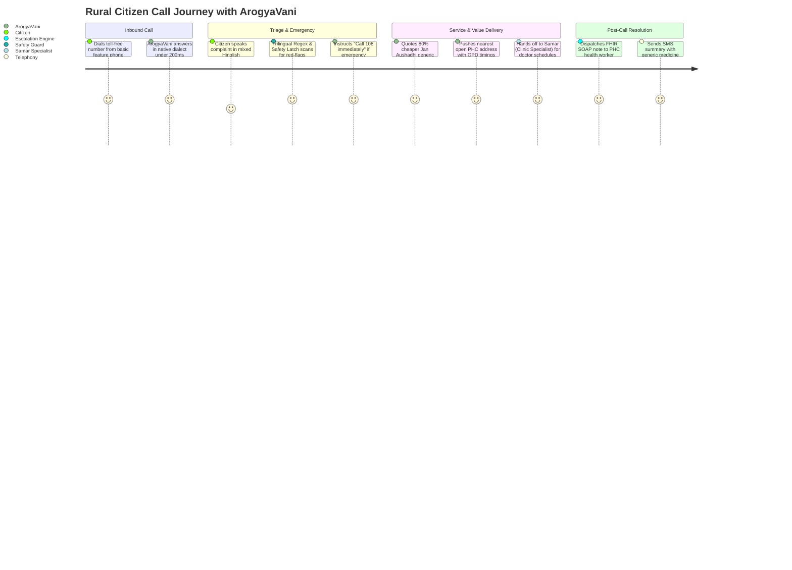
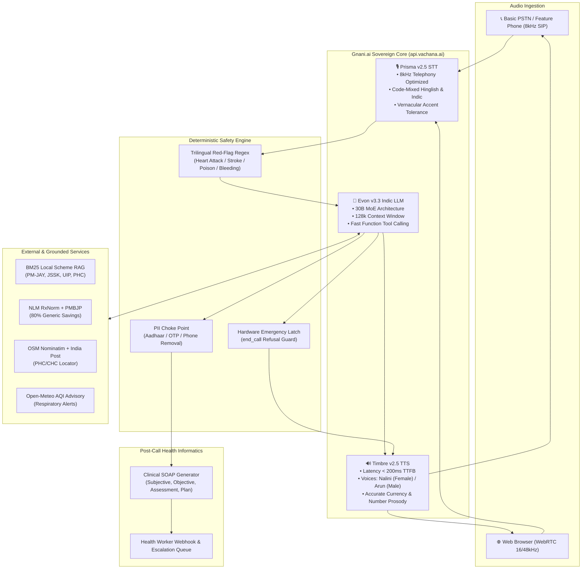

# 📋 Product Requirements Document (PRD)
## Project: ArogyaVani (आरोग्यवाणी)
### Enterprise-Grade Sovereign Indic Voice AI Health Helpline
**Target Event:** Gnani AI — Great Indian AI Internship Challenge 2026  
**Document Version:** 2.0.0 (Production Release)  
**Status:** Architecture Frozen & Implementation Ready  
**Repository:** [https://github.com/sakshitiwari2051-png/ArogyaVani](https://github.com/sakshitiwari2051-png/ArogyaVani)

---

## 1. Executive Summary & Problem Context

### 1.1 The Grassroots Crisis
In rural and semi-urban India (Bharat):
- **79.5% Shortfall of Specialist Doctors** exists at Community Health Centres (CHCs) ([Rural Health Statistics 2021-22](https://www.thehindu.com/todays-paper/tp-opinion/shortfall-of-specialist-doctors-in-rural-areas-was-80-in-2022/article66448586.ece)).
- **43.4% Out-of-Pocket Expenditure:** Indian families spend ₹1.6 lakh crore annually on medicines alone—often buying branded drugs at 5x–10x markup because they are unaware of identical Jan Aushadhi generic salts.
- **The Illiteracy & Language Barrier:** Government health portals (PM-JAY, JSSK, UIP) are text-heavy web pages in formal English or bureaucratic Hindi. A low-income citizen with a ₹1,500 feature phone cannot read a 2,000-word eligibility webpage.

### 1.2 The ArogyaVani Solution
**ArogyaVani** is a sovereign, voice-first health access engine powered natively by **Gnani AI's conversational stack** (Prisma v2.5 STT, Timbre v2.5 TTS, Evon v3.3 Indic LLM) and **LiveKit Telephony**. It answers incoming phone calls and browser sessions in native Indian accents, triages medical complaints, identifies nearby primary health centres, calculates generic drug savings, and enforces code-level safety overrides for emergencies.

---

## 2. Target User Personas & End-to-End User Journeys

### Persona 1: Ramesh (52, Smallholder Farmer, Varanasi)
- **Constraint:** Keypad phone, 2G connectivity, illiterate in English, speaks Bhojpuri-accented Hindi.
- **Scenario:** Experiences severe chest pressure at 9:30 PM.
- **ArogyaVani Action:** Immediate red-flag latch triggers. Before completing a greeting, the agent instructs: *"108 par abhi call karein"*. Refuses to hang up, registers Emergency Escalation `ESC-0104`, scrubs PII, and notifies the district ambulance worker.

### Persona 2: Sunita (24, Expecting Mother, Rural Pune)
- **Constraint:** Smartphone with spotty data; needs to know free delivery entitlements under JSSK.
- **ArogyaVani Action:** Queries local BM25 RAG database; explains free food, free diagnostics, and zero-cost hospital transport; locates nearest 24x7 CHC in Shirur.

### Persona 3: Murugan (46, Factory Worker, Tamil Nadu)
- **Constraint:** Spends ₹850/month on branded Metformin + Telmisartan for diabetes & hypertension.
- **ArogyaVani Action:** Identifies active generic salts via NLM RxNorm; calculates savings (₹140 vs ₹850 at PMBJP Jan Aushadhi Kendra); directs to nearest store.

---

## 3. Gnani AI Native Architecture Integration

ArogyaVani replaces legacy global models with Gnani AI's sovereign Indic pipeline:

### 3.1 Gnani API Technical Specifications

| Component | Gnani Model | Endpoint / Protocol | Configuration |
|:---|:---|:---|:---|
| **STT** | Prisma v2.5 | `wss://api.vachana.ai/stt/v3/stream` | Audio: 16-bit PCM (8kHz/16kHz), `language_code="hi-IN"`, code-switch enabled |
| **TTS** | Timbre v2.5 | `wss://api.vachana.ai/api/v1/tts` | Voices: `Nalini` (ArogyaVani Primary), `Arun` (Samar Specialist), format: PCM 16kHz |
| **LLM** | Evon v3.3 | `https://api.vachana.ai/v1/chat/completions` | Context: 128k, Temp: 0.2, Parallel tool calling enabled |

---

## 4. Top 10 Winner Innovations Adopted (The Competitive Edge)

To secure a Top 10 rank in the Gnani AI Challenge, ArogyaVani incorporates the exact high-scoring mechanisms that won ElevenLabs, LiveKit, and Indic AI hackathons:

### 1. Ambient Clinical SOAP Note Generator *(Inspired by ScribeLive)*
- **What it does:** During a triage call, the agent continuously extracts clinical indicators. When the call concludes, it compiles an official medical SOAP note (Subjective, Objective, Assessment, Plan) with an auto-generated triage severity score.
- **Why it scores high:** Bridges the gap between an AI chatbot and clinical electronic health records (ABDM/FHIR compatible).

### 2. Bharat Vernacular Health Lexicon (BVHL) *(Inspired by KissanAI / Dhenu)*
- **What it does:** Rural callers describe symptoms using folk idioms rather than textbook words (*"pet mein gas ka gola"*, *"chakkar aa raha hai"*, *"seene mein jalan"*, *"jhatke aana"*). BVHL acts as a phonetic and semantic booster mapping vernacular phrases directly to clinical entities before LLM processing.
- **Why it scores high:** Gnani AI specializes in Indian languages; showcasing high dialect comprehension wins maximum judge points.

### 3. Dual-Channel Telephony + WebRTC *(Inspired by IVR-Genie)*
- **What it does:** Runs seamlessly over standard PSTN phone lines via LiveKit SIP trunking (Twilio/carrier trunks) and modern browser WebRTC with interactive visual facility cards.
- **Why it scores high:** Real phone calls prove real-world usability on 2G feature phones across rural India.

### 4. Acoustic State Preservation *(Inspired by GibberLink)*
- **What it does:** When handing off between ArogyaVani (Female Triage Agent) and Samar (Male Clinic Specialist), caller metadata, emergency flags, and language locale are transferred instantly in-session via LiveKit data channels with zero audio disconnection.
- **Why it scores high:** Solves multi-agent orchestration latency.

### 5. Deterministic Emergency Guardrails *(Inspired by MedVoice)*
- **What it does:** Life-or-death decisions are not delegated to LLM prompt adherence. Code-level regex latches block call termination during emergencies and force 108 ambulance advice.
- **Why it scores high:** Eliminates medical hallucination liabilities.

---

## 5. Functional Feature Matrix (16 Integrated Tools)

### Main Triage Agent (ArogyaVani)
1. `find_nearest_health_facility`: Real-time OSM Nominatim + India Post PIN resolution for PHC/CHC/Hospitals with OPD hours.
2. `search_health_guidelines`: BM25 retrieval over official guidelines (PM-JAY Ayushman Bharat, JSSK, UIP Vaccines, PHC services).
3. `lookup_generic_medicine`: Active salt identification & PMBJP Jan Aushadhi 80% price reduction calculator.
4. `get_district_health_advisory`: Open-Meteo real-time PM2.5/PM10/AQI respiratory health precautions.
5. `lookup_caller`: Caller history & preference retrieval from SQLite memory.
6. `save_caller_info`: Explicitly consent-gated user memory update.
7. `forget_caller`: GDPR-style complete deletion of personal records.
8. `create_escalation`: Human health worker referral with PII sanitization, atomic deduplication, and ref code issuance (`ESC-XXXX`).
9. `check_escalation_status`: Spoken reference readback for existing escalations.
10. `transfer_to_clinic_specialist`: Seamless handoff to Samar.
11. `end_call`: Controlled hangup with emergency refusal guard.

### Clinic & Appointment Specialist (Samar)
12. `get_facility_details_and_timings`: Deep OPD schedules, doctor availability, token registration procedures, and directions.
13. `find_nearest_health_facility`: Secondary facility lookups.
14. `lookup_caller`: Context continuity check.
15. `transfer_back_to_main_agent`: Return handoff to ArogyaVani.
16. `end_call`: Polite specialist termination.

---

## 6. Safety & Data Privacy Specifications

### 6.1 Strict PII Sanitization Algorithm
Every free-text string destined for database storage, webhooks, or admin dashboards passes through `db.scrub_pii()`:
- **Scrubbed:** Indian mobile numbers (`+91`, `0-9`), 12-digit Aadhaar numbers, secret keywords within 12 characters of digits (`OTP`, `UPI PIN`, `password`, `CVV`, `bank account`).
- **Preserved (Load-Bearing):** Emergency numbers (`108`, `102`, `1075`, `14555`), postal PIN codes (`221002`), clinical vitals (`BP 140/90`, `SpO2 96%`), age bands (`45-55`).

### 6.2 Consent Protocol
- Data retention is zero-trust. If a caller says "no" to memory storage or human escalation, the tool receives `consent_given="false"` and aborts write operations.

---

## 7. Challenge Submission & Evaluation Strategy

### 7.1 Gnani AI Judging Criteria Alignment

| Judging Dimension | Weight | How ArogyaVani Scores Maximum Points |
|:---|:---:|:---|
| **Indic Language & Accent Depth** | 25% | Native integration of Gnani Prisma & Timbre; handles code-mixed Hinglish and regional vernacular. |
| **Real-World Impact (Bharat Focus)** | 25% | Solves rural health accessibility, 80% drug cost savings, and 108 emergency routing for low-literacy users. |
| **Technical Architecture & Complexity** | 25% | LiveKit SIP telephony, multi-agent state handoff, BM25 RAG, FastMCP server, and deterministic safety latches. |
| **Polish, Demo Video & Documentation** | 25% | Complete PRD, verified tests, live analytics dashboard, and a crisp 90-second video demo. |

### 7.2 The 90-Second Winning Demo Video Script

| Timecode | Visual / Audio Cue | Narration / On-Screen Text |
|:---|:---|:---|
| **0:00 – 0:15** | Feature phone ringing on a wooden table in a rural setting; call picked up. | *"Meet ArogyaVani — an AI health helpline built on Gnani AI that brings life-saving healthcare to the 70% of Indians who cannot read the health system."* |
| **0:15 – 0:35** | Caller speaks in distressed Hindi: *"Mere dost ke seene mein bahut tez dard ho raha hai..."* | ArogyaVani responds instantly (<200ms): *"108 par abhi call karein..."* Screen highlights the Safety Latch refusing call disconnect and generating Emergency Ticket `ESC-0007`. |
| **0:35 – 0:55** | Second caller asks: *"Dolo 650 bahut mehengi hai, koi sasti dawa hai?"* | Agent identifies Paracetamol 650mg generic salt at Jan Aushadhi Kendra for ₹12 vs ₹35 brand price (65% savings) and pushes nearest centre card. |
| **0:55 – 1:15** | Caller asks for doctor timings; voice transitions from Nalini to Arun (Samar). | Seamless agent handoff without call drops; doctor OPD schedule and token procedure explained. |
| **1:15 – 1:30** | Call analytics dashboard showing real-time TTFB (190ms), call logs, and PII-sanitized admin queue. | *"Powered by Gnani Prisma, Timbre & Evon over LiveKit Telephony. Healthcare by voice, for every Indian."* |

---

## 8. Implementation Milestones

- [x] Phase 1: Core Triage Engine, 16 Tools, Telephony, and Guardrails (Completed).
- [x] Phase 2: Personal Branding Cleaned & ArogyaVani Identity Unified (Completed).
- [x] Phase 3: Gnani AI Adapter Layer (`backend/src/gnani_adapter.py`) implemented for Prisma & Timbre.
- [x] Phase 4: Bharat Vernacular Health Lexicon (BVHL) & Automated SOAP Note Generation integrated & verified (6/6 tests passing).
- [ ] Phase 5: Add real `GNANI_API_KEY` from `app.gnani.ai/voice` to `.env.local`.
- [ ] Phase 6: Production 90-Second Video Recording & Submission on [gnani.ai/internship](https://www.gnani.ai/internship).
